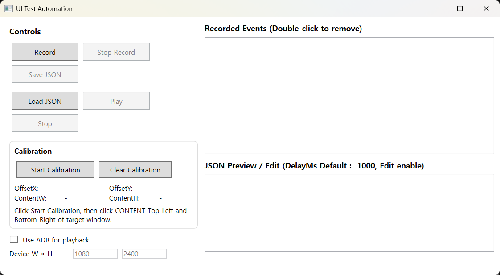

# UITestAutomation

A small Windows tool that records mouse clicks and key presses against one window and plays them back.
It is meant for repeating manual UI test steps and simple desktop workflows.
Playback can also go to an Android emulator or device through ADB.



## What it does

- Records left clicks and key presses with the real gap between them
- Stores clicks relative to the target window, so playback still lands if the window moves
- Saves the target window title in the macro file and finds the window again on Play
- Keeps arrow keys, Delete, Home/End and other extended keys correct on playback
- Edits as plain JSON, applied when you press Play
- Optional ADB playback: clicks become `adb shell input tap`, some keys become `adb shell input keyevent`
- Stop playback any time with **Ctrl + Alt + X**
- Per-Monitor DPI aware, multi-monitor

It does not record mouse movement, drags, right clicks or the mouse wheel.
It does not look at the screen, so if the target app shows something different, playback clicks anyway.

## Download

Get `UITestAutomation_vX.Y.Z.zip` from [Releases](https://github.com/loganMongmu/UITestAutomation/releases).
It is a single self-contained `.exe` for Windows 10/11 x64, so nothing else needs to be installed.
Each release lists the SHA256 of the zip.

## How to use

### Record

1. Click **Record** and type part of the target window title (for example `Notepad`).
2. Click and type in that window.
3. Press **ESC** or click **Stop Record**.

ESC ends the recording and is not saved as an event.
Clicks on UITestAutomation's own window are not recorded either.

### Play

Open the target window, then click **Play**.
The first event waits one second so you have time to let go of the mouse.

If you loaded a macro from a file, the window is found by the title saved in it.
If no window with that title is open, playback does not start.

### Save and load

**Save JSON** writes the macro. **Load JSON** reads it back.
You can also start the app with a file: `UITestAutomation.exe my_macro.json`.

### Calibration (for ADB)

ADB playback needs to know which part of the window is the phone screen.
An emulator window usually has a toolbar or black bars around the screen.

1. Record against the emulator window once, so the target is set.
2. Click **Start Calibration**.
3. Click the top-left corner of the phone screen, then the bottom-right corner.
4. Set **Device W × H** to the device resolution and check **Use ADB for playback**.

If you resize the emulator window, calibrate again.

## Macro file

```json
{
  "TargetTitle": "Notepad",
  "Events": [
    { "Type": "MouseClick", "X": 300, "Y": 200, "DelayMs": 1000 },
    { "Type": "KeyDown", "VkCode": 37, "ScanCode": 75, "Extended": true, "DelayMs": 300 },
    { "Type": "KeyUp", "VkCode": 37, "ScanCode": 75, "Extended": true, "DelayMs": 80 }
  ]
}
```

| Field | Meaning |
|---|---|
| `TargetTitle` | Part of the window title. Empty or missing means `X`/`Y` are absolute screen pixels |
| `Calibration` | Optional. `OffsetX`, `OffsetY`, `ContentW`, `ContentH` of the content area inside the window |
| `Type` | `MouseClick`, `KeyDown` or `KeyUp`. Numbers `0`, `1`, `2` from 1.0.0 files also work |
| `X`, `Y` | Client-area pixels of the target window (content pixels when calibrated) |
| `VkCode`, `ScanCode` | Windows virtual-key and scan codes |
| `Extended` | `true` for arrow keys, Insert/Delete, Home/End, PageUp/PageDown, right Ctrl/Alt |
| `DelayMs` | Wait before this event. `0` is allowed |

1.0.0 files (a bare JSON array of events) still load.

## Notes

- Run UITestAutomation and the target app at the same privilege level. Windows blocks input from a normal app into an elevated one.
- Windows drops synthetic input while the screen is locked.
- ADB playback needs `adb` on `PATH`.

## Build

Requires the .NET 8 SDK.

```bash
dotnet build UITestAutomation.sln -c Release
dotnet test UITestAutomation.sln -c Release
dotnet publish UITestAutomation/UITestAutomation.csproj -c Release -p:PublishProfile=FolderProfile
```

| Folder | Contents |
|---|---|
| `UITestAutomation/` | WPF app: hooks, playback, UI |
| `UITestAutomation.Core/` | Coordinate mapping, macro file format, timing. No Windows dependency |
| `UITestAutomation.Tests/` | Unit tests for Core |
| `tools/click-check/` | Click accuracy check on a real desktop (see the script header) |

## Changes

See [CHANGELOG.md](CHANGELOG.md).

## Contributing

Issues and pull requests are welcome.
If you change coordinate or file-format code, add a test in `UITestAutomation.Tests`.

## License

[MIT](LICENSE). See also [NOTICE](NOTICE).

If this tool saved you some time, you can [buy me a coffee](https://buymeacoffee.com/loganjung).

Contact: logan@calmingx2.com

---

### 한국어 요약

창 하나를 정해 마우스 클릭과 키 입력을 녹화하고 그대로 재생하는 Windows 도구입니다.
손으로 반복하던 UI 테스트 단계를 줄이려고 만들었습니다. ADB로 안드로이드 에뮬레이터에도 재생할 수 있습니다.
1.1.0에서 재생 클릭이 제목 표시줄 높이만큼 밀리던 문제, 방향키가 숫자 키패드 키로 재생되던 문제, 예제 파일을 읽지 못하던 문제를 고쳤습니다.
자세한 내용은 [CHANGELOG.md](CHANGELOG.md)에 있습니다.
